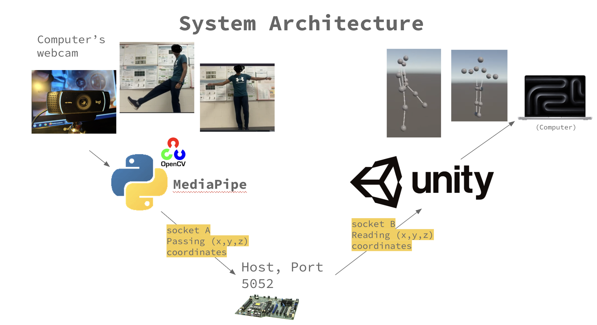
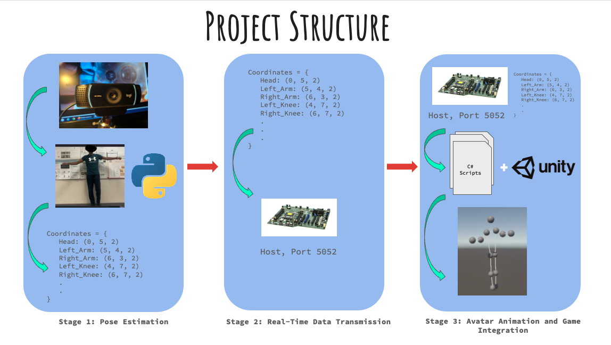
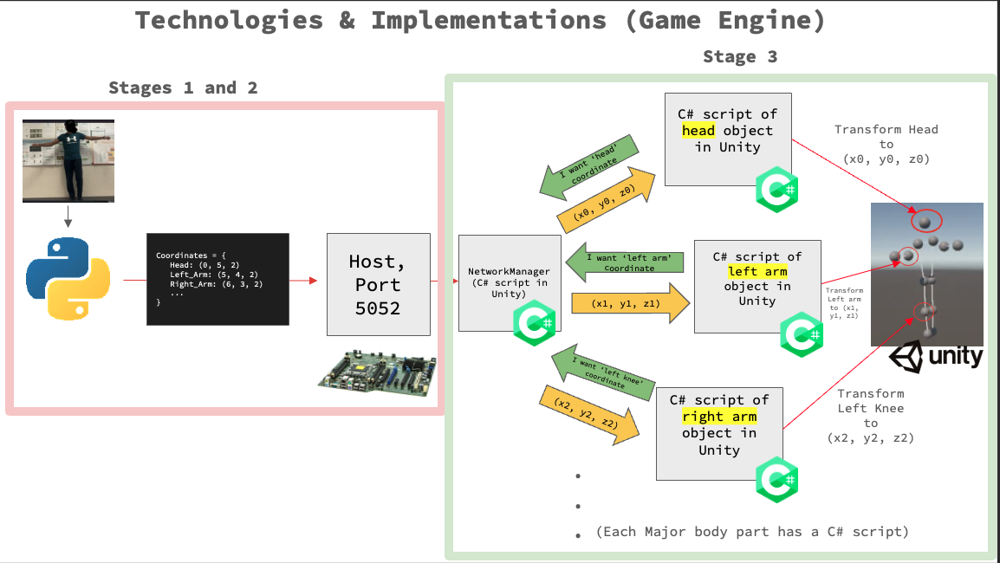

# VisionPong: A Computer Vision-Based Motion-Controlled Game Interface

**Aneesh Pabolu**  
Thomas Jefferson High School for Science and Technology  
Senior Research Project • 2026


## Overview

<p align="center">
  
</p>

VisionPong investigates whether a standard RGB webcam can be used to create an immersive, motion-controlled gaming experience without specialized hardware such as VR controllers, motion capture suits, depth cameras, or wearable sensors. Motion-controlled gaming systems, such as the Xbox Kinect, demonstrated the potential for full-body interaction but relied on dedicated depth-sensing hardware. VisionPong explores whether recent advances in monocular human pose estimation can enable similar forms of interaction using only a conventional RGB camera.

The project combines modern human pose estimation, real-time networking, and 3D game development to translate a player's physical movements into an interactive Unity environment. Rather than relying on traditional input devices, VisionPong uses full-body pose estimation to control an in-game avatar in real time.

Beyond serving as a playable prototype, the project investigates both the capabilities and the limitations of monocular pose estimation for interactive applications, with particular emphasis on bridging the gap between image-space pose estimation and physically meaningful movement within a three-dimensional virtual environment. To evaluate these concepts, the research is implemented through the development of a custom Table Tennis simulation, providing a controlled environment in which pose estimation, player movement, and real-time interaction can be analyzed.

---

# System Architecture & Methodology
VisionPong utilizes a Python script to capture successive RGB video frames using OpenCV and perform real-time human pose estimation using Google's MediaPipe Pose Estimation model. For each frame, the model predicts 13 body landmarks represented by normalized image coordinates, which are subsequently transmitted to the Unity game engine for avatar animation.

The system consists of four major components:

```
Webcam
    │
    ▼
MediaPipe Pose Estimation
    │
    ▼
Python Processing Pipeline
    │
 UDP Socket Communication
    │
    ▼
Unity Game Engine
    │
    ▼
Realtime Avatar Animation
```

A more detailed breakdown is as follows:
<p align="center">
  
</p>


# Repository Structure

The VisionPong pipeline is divided into three primary stages:

1. **Pose Estimation** – Capturing RGB video frames using OpenCV and estimating human body landmarks with the MediaPipe Pose model.
2. **Real-Time Data Transmission** – Serializing the estimated landmark coordinates into JSON packets and transmitting them to Unity over a UDP socket.
3. **Avatar Animation and Game Integration** – Receiving landmark data in Unity and animating a three-dimensional avatar within the game environment using C# scripts.

<p align="center">
  
</p>

The first two stages are implemented in Python and can be found in the **`Python_Script`** directory. The third stage is implemented in C# within Unity and can be found in the **`Unity_Scripts`** directory.

Supporting documentation for the project, including the research paper, presentation, and poster, is available in the **`docs`** directory.

# Technologies & Implementation

## Computer Vision

- Google MediaPipe Pose Estimation Model
- OpenCV
- Python

The MediaPipe Pose model predicts 13 anatomical landmarks from a monocular RGB camera stream. Landmark coordinates are extracted and serialized into JSON packets.

---

## Networking

The Python computer vision pipeline communicates with Unity using the **User Datagram Protocol (UDP)**. Each frame's landmark data is serialized into a JSON packet and transmitted over a localhost connection to the Unity application.

UDP was selected over connection-oriented protocols such as TCP because it introduces significantly lower communication overhead. Unlike TCP, UDP does not establish a persistent connection or retransmit lost packets, allowing new pose estimates to be streamed with minimal latency. For real-time avatar animation, receiving the most recent body pose is more important than guaranteeing delivery of every intermediate packet, making UDP well suited for low-latency motion tracking applications.

---


## Game Engine

Unity serves as the visualization and interaction environment for VisionPong. The Python application continuously streams pose estimation data to Unity, where it is converted into a real-time animated avatar.

The Unity implementation is centered around the **`NetworkManager.cs`**, which listens for incoming UDP packets from the Python pipeline. Each packet contains the most recent landmark coordinates serialized in JSON format. Upon receiving a packet, the `NetworkManager.cs` deserializes the data into a `PosePacket` object, making the latest pose information globally accessible to the remainder of the Unity project.

Each tracked body landmark (nose, shoulders, elbows, wrists, hips, knees, and ankles) is represented by an individual **GameObject** within the Unity scene. For visualization purposes, each GameObject is implemented as a simple sphere, allowing the tracked landmark positions to be observed independently during development and debugging. Every GameObject is associated with its own dedicated movement script (e.g., `HeadMover.cs`, `Right_Wrist_Mover.cs`, `Left_Knee_Mover.cs`, etc.). During every Unity frame, these scripts read the latest landmark coordinates from the `NetworkManager.cs` and update the corresponding GameObject's position, allowing the virtual skeleton to mirror the user's movement in real time.

To provide a visual representation of the human body, the **`BoneLine.cs`** script dynamically connects neighboring landmark GameObjects using Unity's `LineRenderer` component. Rather than performing additional pose estimation, this script simply draws line segments between adjacent joints, producing a continuously updated skeletal model.

Together, these scripts separate networking, landmark animation, and skeletal rendering into independent components, resulting in a modular architecture that simplifies debugging, maintenance, and future expansion of the project.

For a visual representation of this information, refer to the "stage 3" section of the following diagram:
<p align="center">
  
</p>

---

# Coordinate Systems

Implementing VisionPong required understanding the relationship between MediaPipe's normalized image coordinate system and Unity's world-space coordinate system. Since the two systems represent spatial information differently, transforming landmark positions between them was essential for accurately animating the virtual avatar.

MediaPipe outputs landmark positions in normalized image space:

- x : horizontal image coordinate
- y : vertical image coordinate
- z : estimated relative depth

Transforming between these representations required careful handling of:

- axis orientation
- scaling
- body-relative positioning
- local versus global transforms

Consequently, significant effort was devoted to studying:

- Perspective projection
- Coordinate normalization
- Body-relative coordinate systems
- World-space reconstruction
- Translation versus articulation (explained in the following section)

---

# Technical Challenges

Several nontrivial challenges arose during the development of VisionPong.

## Body Translation and Joint Articulation

One of the primary challenges encountered during development was implementing **body translation**.

**Body translation** refers to the movement of the entire body through three-dimensional space, such as walking forward, backward, or sideways while maintaining the same pose. In contrast, **joint articulation** refers to the movement of body parts relative to one another, such as bending an elbow, raising an arm, or flexing a knee.

The MediaPipe Pose model excels at estimating **joint articulation**. Because the model predicts the relative positions of anatomical landmarks, it is highly effective at reconstructing the posture of the human body and detecting limb movement in real time. As a result, movements such as raising an arm, bending a knee, or turning the head are accurately reflected by the corresponding virtual avatar. 

The MediaPipe Pose model also excelled at recognizing when a human body moved left and right relative to the camera, however, it struggled significantly in detecting relative depth of the human body from the camera. A monocular camera observes only a two-dimensional projection of a three-dimensional scene. Consequently, when a person moves toward or away from the camera, the apparent change in body size caused by perspective projection is often much greater than the estimated change in the landmark depth values. Directly mapping these landmark coordinates into Unity therefore caused the virtual avatar to appear to grow or shrink in size rather than physically translating through the virtual environment.

## Proposed Solution

To better estimate body translation, the next stage of VisionPong will focus on improving depth estimation for a monocular RGB camera.

The current MediaPipe Pose model provides excellent estimates of body articulation but struggles to accurately estimate forward and backward movement using a single RGB camera. My first approach will be to investigate **Ultralytics YOLO's Monocular Depth Estimation** model, which is designed to infer scene depth from a single RGB image. By incorporating a dedicated monocular depth estimation model into the computer vision pipeline, I hope to obtain a more accurate estimate of the player's forward and backward translation before transmitting positional data to Unity.

If this approach does not produce sufficiently accurate results, I plan to develop a custom depth estimation algorithm using the pose landmarks generated by MediaPipe. This approach will estimate depth by observing how the apparent distances between stable body landmarks, such as shoulder-to-shoulder or hip-to-hip, change over time. As these measured landmark distances increase, the user is likely moving closer to the camera, while decreasing distances indicate movement farther away.

The goal of either approach is to compensate for the perspective scaling inherent to monocular vision, allowing the avatar to physically translate throughout the virtual environment rather than simply appearing to grow or shrink as the player moves toward or away from the camera.

---

# Acknowledgements

VisionPong was built using several open-source technologies, including OpenCV and Google's MediaPipe Pose Estimation model.

The 3D simulation was developed using the Unity game development engine: https://unity.com/

Some environment assets (including select trees and rocks) were sourced from the **Ultimate Nature – Starter** asset package by **Innerverse Interactive**, available through the Unity Asset Store: https://assetstore.unity.com/packages/3d/environments/ultimate-nature-starter-176906

All computer vision, networking, Unity scripting, avatar animation, game mechanics, and remaining project assets were developed as part of VisionPong.
